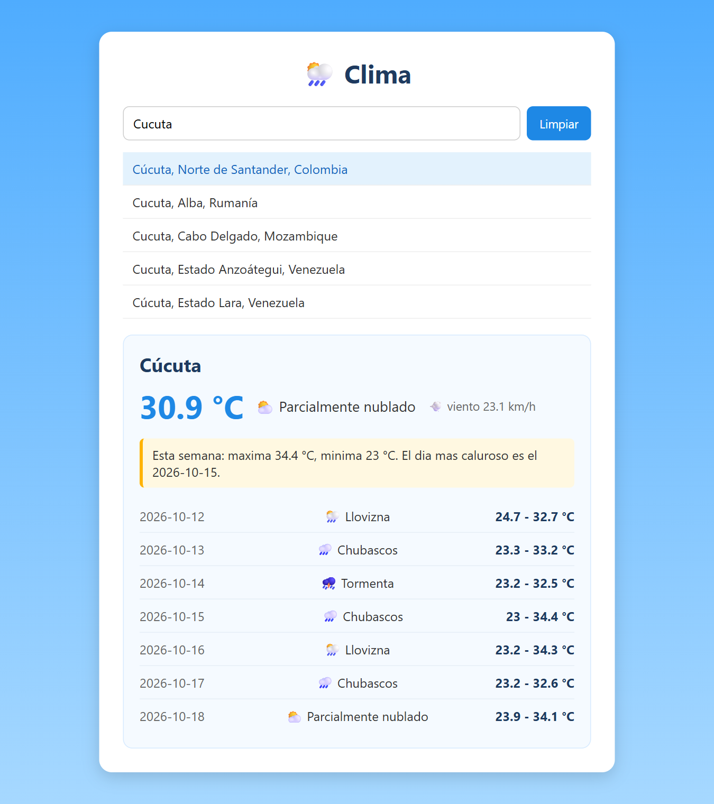

# 🌦️ Clima · Buscador de pronóstico en React


App en **React + Vite** para buscar cualquier ciudad del mundo y ver el clima de hoy y el pronóstico de los próximos 7 días. Usa la API gratuita de [Open-Meteo](https://open-meteo.com/), que no necesita registro ni API key.

<p align="center">
  
</p>

## ✨ Qué hace

- 🔎 **Busca ciudades** mientras escribes (desde 3 letras) y muestra hasta 5 resultados.
- ⏱️ **No busca con cada tecla**: espera 400 ms a que dejes de escribir (*debounce*).
- 🌡️ **Clima actual** de la ciudad que elijas: temperatura, estado del cielo y viento.
- 📅 **Pronóstico de 7 días** con mínima y máxima de cada día.
- 📈 **Resumen de la semana**: temperatura más alta, más baja y el día más caluroso.
- 🧹 **Botón Limpiar** que borra la búsqueda y vuelve a poner el cursor en el input.
- ⏳ Mensajes de *cargando*, *sin resultados* y de error.
- 🎨 **Diseño propio con CSS** que también se adapta al celular.

## 🚀 Cómo correrlo

Necesitas [Node.js](https://nodejs.org/es/download) instalado y conexión a internet (la app consulta la API).

```bash
npm install
npm run dev
```

Luego abre la dirección que muestra la terminal (normalmente http://localhost:5173).

## 🗂️ Estructura

```
src/
├── App.jsx                  ← buscador, ciudad elegida y resumen semanal
├── App.css                  ← estilos de la tarjeta, el buscador y el pronóstico
├── index.css                ← estilos generales (fondo, botones, inputs)
├── clima.js                 ← convierte el código del clima en texto + emoji
├── hooks/
│   ├── useFetch.js          ← pide datos a una URL (con cargando, error y AbortController)
│   └── useDebounce.js       ← retrasa un valor hasta que deja de cambiar
└── componentes/
    ├── ListaCiudades.jsx    ← resultados de la búsqueda
    └── Pronostico.jsx       ← clima de hoy y de los 7 días
```

## 📚 Lo que practiqué

- `useEffect` para hacer peticiones con `fetch` y cancelarlas con `AbortController` cuando cambia la URL.
- Crear **hooks propios** (`useFetch` y `useDebounce`) para reutilizar lógica.
- `useMemo` para no recalcular el resumen de la semana en cada render.
- `useRef` para manejar el foco del input.
- Consumir una API REST pública y mostrar sus datos.
- Darle estilo con CSS usando clases, flexbox y una media query para celular.

El proyecto se hizo por pasos (del Paso 1 al Paso 6) y cada paso está en el historial de commits.

---

Hecho por **David Camilo Colmenares**, estudiante de Ingeniería de Sistemas en la UFPS. [GitHub](https://github.com/Camilo0812A)
